# Scoreler

Scoreler is a personal AI agent focused on studying.

English | [简体中文](README.zh-CN.md)

Scoreler is a local-first desktop study companion for students. It combines planning, an AI study assistant, learning materials, and small study tools in one Windows application. The interface supports English and Simplified Chinese.

## Screenshots

The screenshots below use an isolated demonstration profile.

### Daily planning

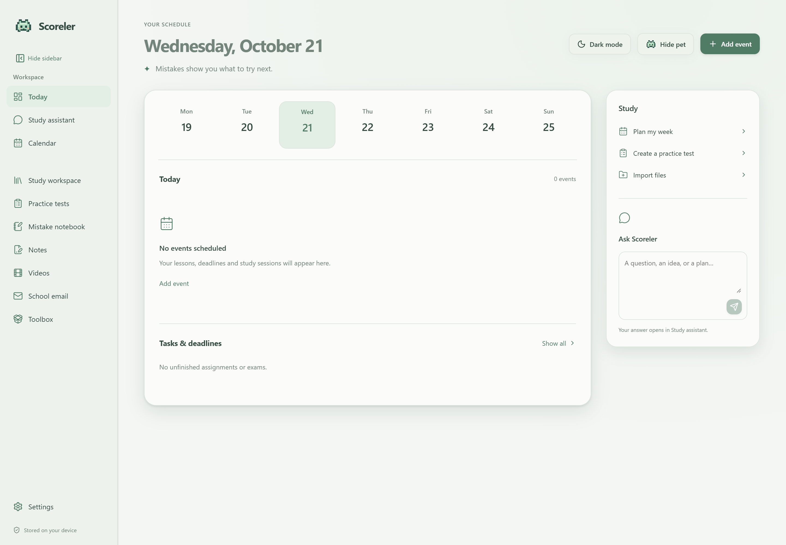

### Calendar

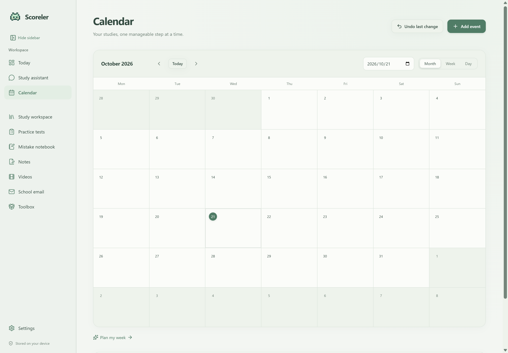

### Study assistant

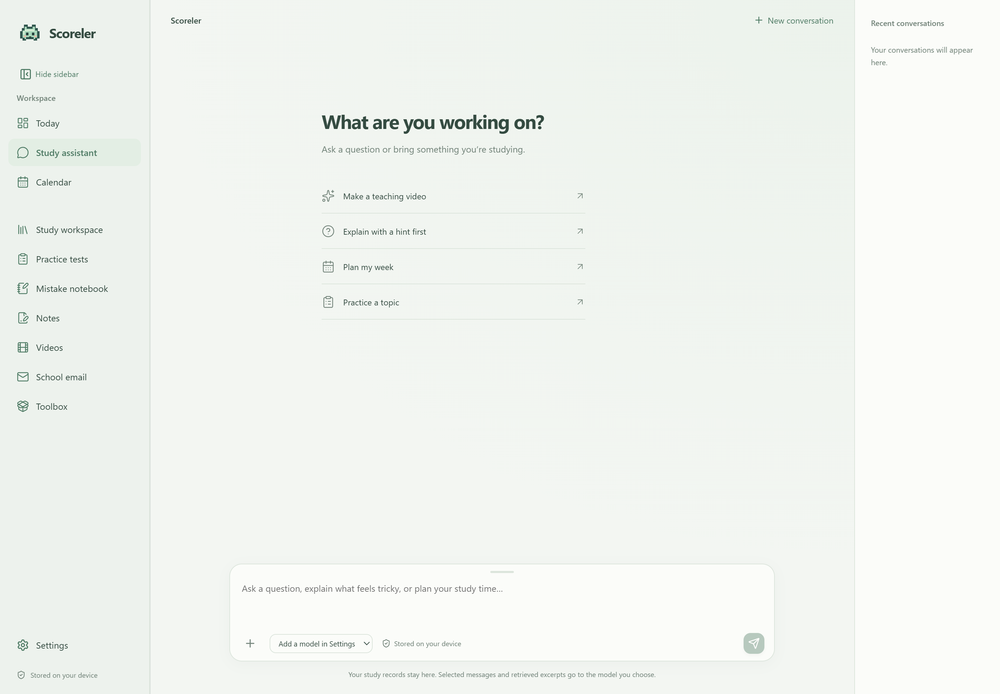

### Study workspace

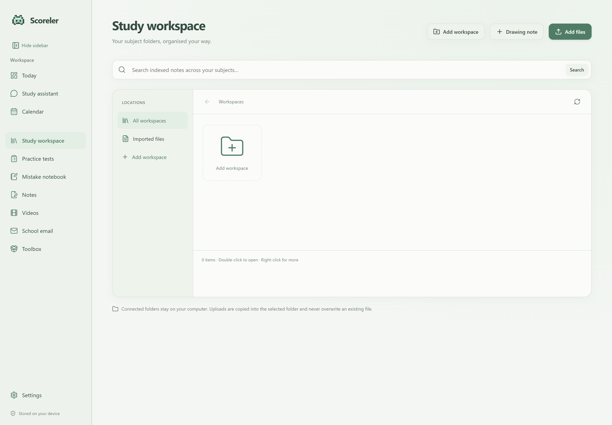

### Notes

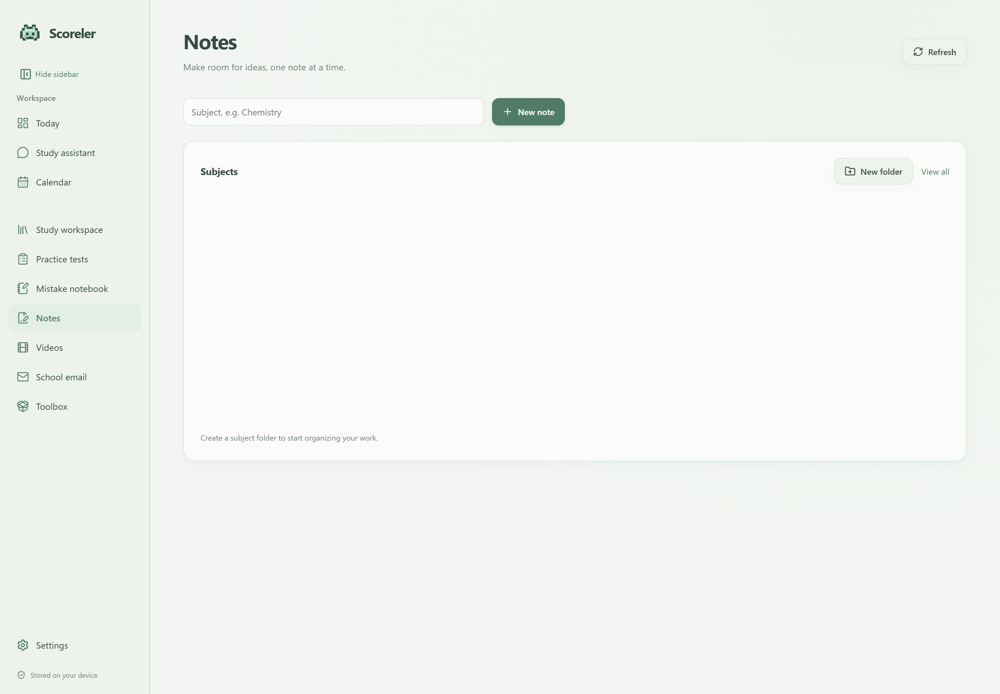

### Teaching videos

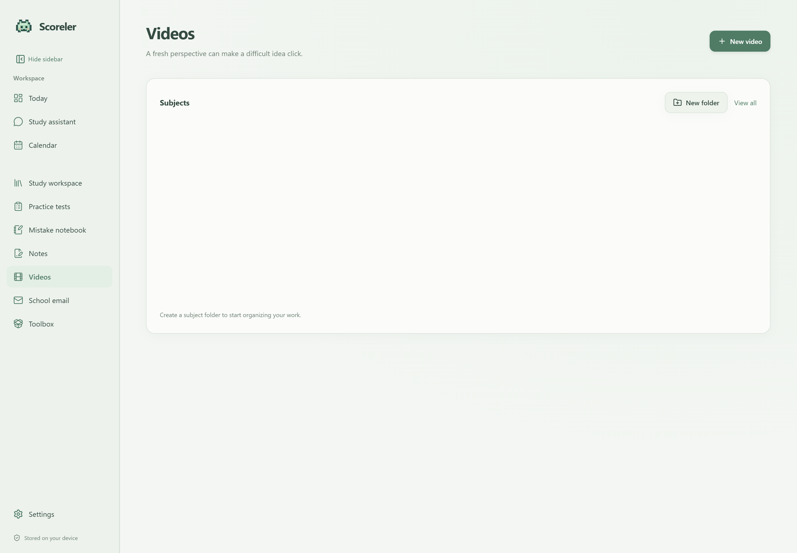

### Practice tests

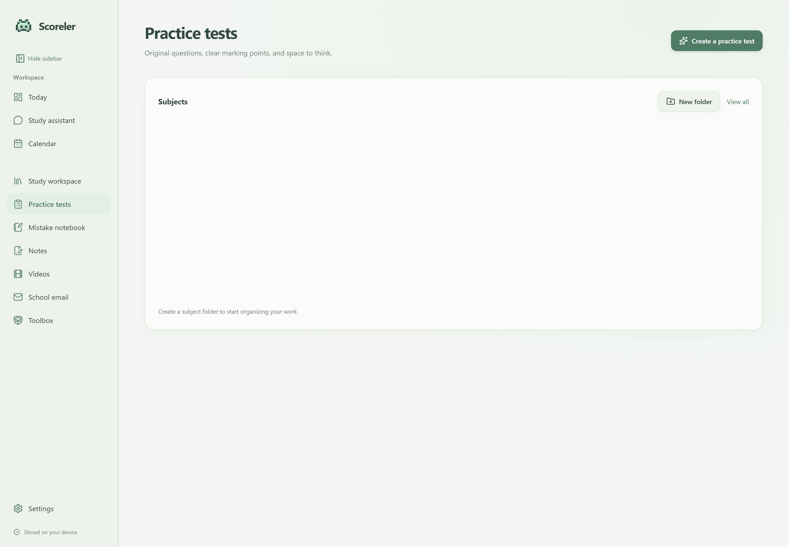

### Mistake notebook

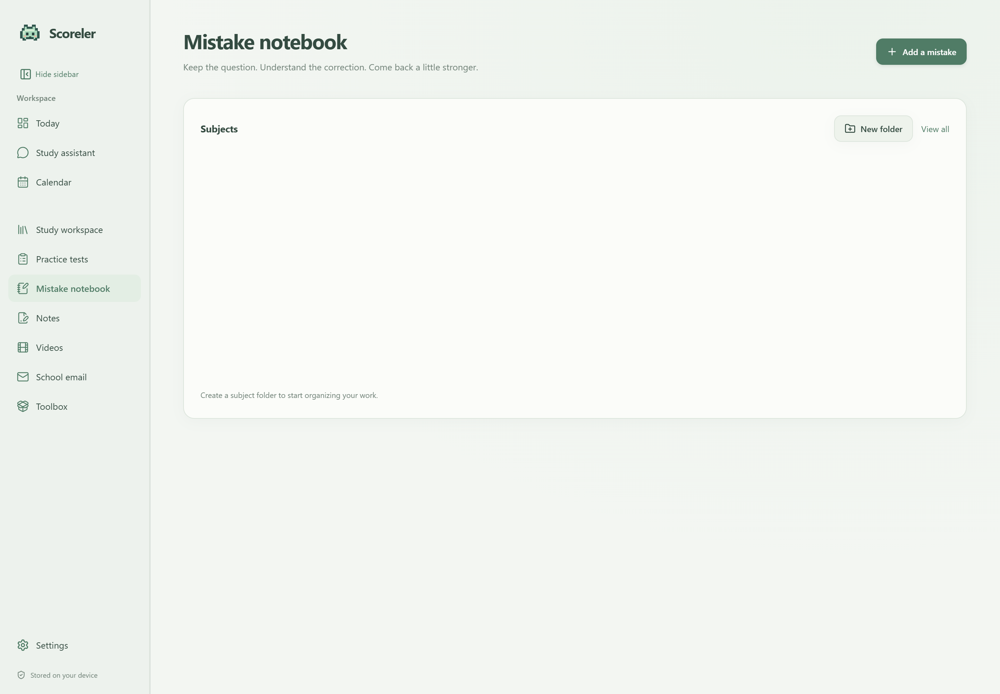

### Email setup

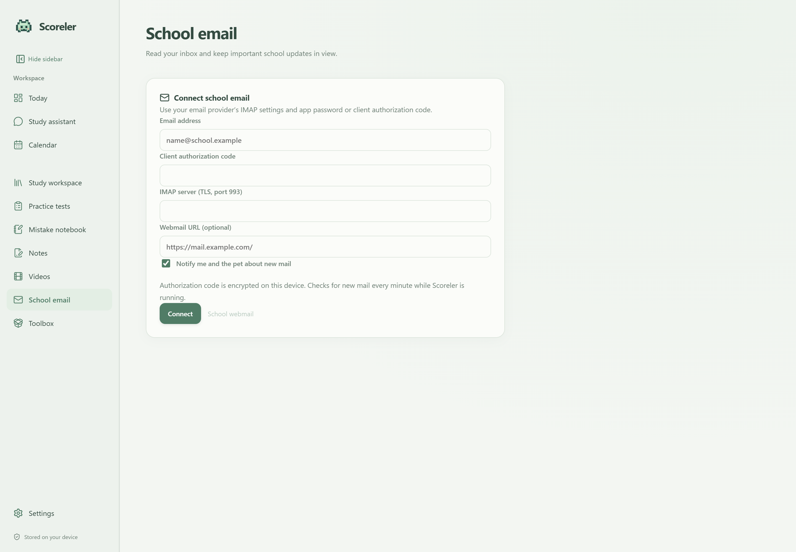

### Toolbox

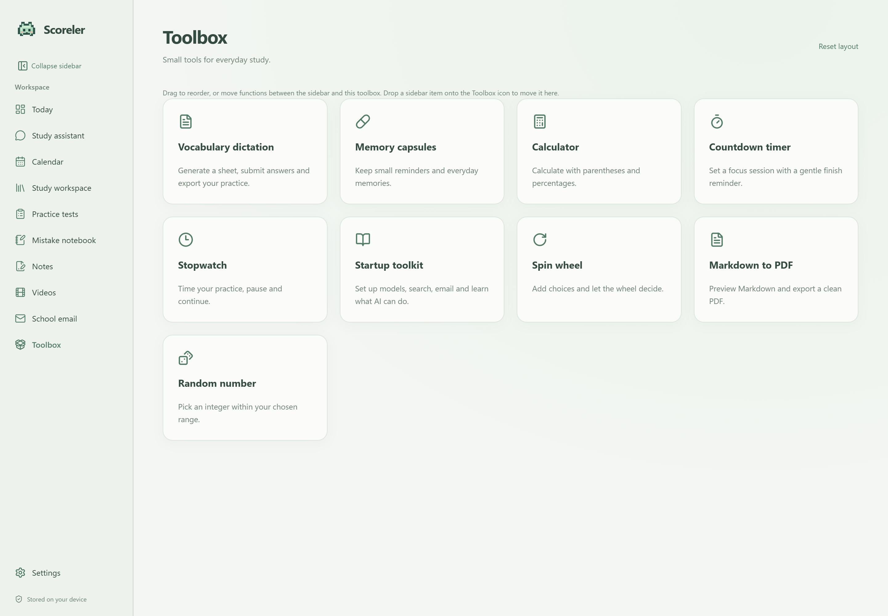

### Dictation practice

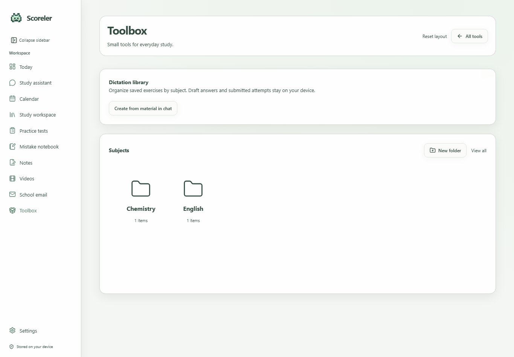

## Features

- **Planning:** calendar events, classes, homework and exam deadlines; task completion; upcoming reminders; elapsed classes hidden from the daily view.
- **AI study assistant:** conversations, image attachments, tool calls, connected-material search, explanations, and user-requested changes to supported study records. Model capabilities depend on the configured provider.
- **Study workspace:** connect local folders, import documents, browse materials and search indexed content. Connected originals remain in their original folders.
- **Notes:** subject folders, drawing and text editing, saved note files, export, and editable “Send to AI” drafts.
- **Teaching videos:** AI-authored lesson scripts rendered locally with Remotion; a subject library, playback, export and lesson discussion. Windows narration uses installed system voices.
- **Practice tests:** subject folders, generated practice papers, attempts, marking guidance, exports and AI discussion. Generated tests are study practice, not official examination papers.
- **Mistake notebook:** subject folders, question/answer/correction screenshots, resolved status, batch selection, PDF/DOCX/PNG export and AI discussion.
- **Memory capsules:** short non-actionable facts in the toolbox that can be created, listed and deleted through the interface or scoped AI tools.
- **Email:** IMAP inbox, search, formatted message reading, clickable links, arrival notifications and AI-assisted summaries. Connection requires a compatible provider and client authorization credentials.
- **Optional campus browser:** explicitly enabled embedded browser, user-configured website shortcuts, persistent sessions and encrypted saved sign-ins. It is disabled initially.
- **Desktop companion:** a draggable pixel pet with daily tasks, completion buttons, reminders, image input, a chat entry point, opening the main window, and screen-edge auto-hide with hover reveal.
- **Appearance:** light/dark modes, four default palettes, and saved custom themes with an RGB background color or local picture and a chosen accent color. The loading screen and running app icon follow your saved appearance. Windows may cache pinned shortcut icons. Drag functions to reorder them or move them between the sidebar and toolbox; a collapsed sidebar keeps its icons accessible.
- **Conversation management:** right-click a recent conversation to delete it after confirmation. Saved study materials, notes and videos remain.
- **Countdown reminders:** the desktop app schedules a system notification when the timer finishes, including while another page is open or the renderer is busy. Windows notification settings apply; the application must remain running.
- **Dictation practice:** Create saved exercises from word-definition pairs in chat images, files or text. Open them from a chat shortcut or the toolbox, type answers, and submit for AI marking against the supplied meaning. Equivalent synonyms are accepted; incomplete definitions may be rejected. Draft answers are saved locally. Supports PDF/PNG/DOCX export. Exported sheets omit answers unless explicitly selected. Uses the configured default model; generated content and marking need review.
- **Toolbox:** startup guide, countdown timer, stopwatch, choice wheel, random numbers and Markdown-to-PDF export. Clock state survives navigation; countdown completion produces an in-app reminder.
- **Source updates:** check the configured source branch and explicitly apply a reviewed fast-forward update while the app is closed.

### Status and practical limits

The application and its scoped study tools are implemented. Automated checks cover selected storage, UI, privacy and updater behavior; they do not prove compatibility with every AI model, email service, website or Windows configuration. Video rendering, provider capabilities and school-site login compatibility should be verified in the environment where they will be used.

The AI can read saved lesson scripts and sources; this is not equivalent to watching video frames. Email attachments are not read by the email agent, and email sending/deletion are not offered. Embedded-site automation by the AI is not implemented. The embedded browser cannot import passwords from another browser; use the system browser for its existing password manager. Installed-app updates download and build a reviewed source snapshot; they do not download a prebuilt installer.

## Windows requirements

- Windows 10/11, 64-bit; Windows 11 is the current development target.
- Node.js 24 or newer, npm, and Git for Windows.
- Network access to npm dependencies and any services you choose to configure.
- Windows PowerShell and a compatible installed speech voice for narrated videos.
- A Chromium browser for Remotion rendering. The renderer can prepare its required browser on first use, which may download browser files.

No separate Python or FFmpeg installation is required for the implemented local video pipeline. Remotion's platform dependencies supply its renderer and encoding tools. Optional document-conversion integrations may require additional tools; missing integrations should not be interpreted as working conversions.

## Install and run from source

Authenticate with GitHub using your own Git Credential Manager credentials if the repository is private. Never put a GitHub token in tracked files, URLs or chat messages.

```powershell
git clone --branch main https://github.com/HansonFeng123/Scoreler.git
cd Scoreler
npm ci
npm run build
npm run desktop
```

`npm ci` executes dependency installation scripts; Electron may download its runtime. Review dependency licenses and scripts before installation. `npm run desktop` rebuilds and launches the Electron application.

Build steps can also be run individually:

```powershell
npm --workspace inno-agent run build
node scripts/scoreler-video-build.mjs
npm --workspace inno-agent-web run build
```

For a browser-only local server, run `npm start` after building and open the loopback URL printed by the server. Desktop-only email, browser and pet integrations require Electron.

```powershell
npm test
npm run test:updater
```

Local Windows packaging is available with `npm run package:win`. It creates local build artifacts; source-repository contents and binary distribution have different licensing considerations. See [THIRD_PARTY_NOTICES.md](THIRD_PARTY_NOTICES.md).

## Configure services

### AI models

Open Settings → Providers and models. Enter a provider name, its documented API type and base URL, your own API key if required, and the exact model ID. Save the provider and select its model in chat. Enable tool calling and image input only when supported by that model and endpoint. These switches do not add capabilities to a model. Provider prices, eligibility, quotas and data policies apply separately.

### Web search

Web research optionally uses a Tavily API key entered in Settings. A model-provider key is not a search key. Search requests go to the search provider; retrieved material may be included in an AI request.

### Email

Enable IMAP with your email provider and obtain an app password or client authorization code when required. Enter the mailbox address, IMAP host, TLS port 993 and authorization code in the email page. Configure an optional webmail URL yourself. OAuth-only or administrator-restricted mailboxes may not support this connection method. An email summary requires both a connected mailbox and a working AI model.

### Embedded browser

Enable the browser in Settings and enter your own HTTPS website addresses. Log in through the website, including any required multi-factor authentication. Saved sessions remain on this device. Website restrictions can prevent embedded login; the system-browser option remains useful for those sites.

## Data, backups and privacy

The desktop application normally stores its profile in `%APPDATA%\scoreler-desktop` and study records under `study`. This includes the SQLite database, chat sessions, generated files, notes, videos, configuration and logs. Browser sessions and local preferences also live in the profile. `SCORELER_HOME` or `--scoreler-home=` can select a different study-data home; use a consistent home when restarting.

The browser-only development server defaults to `runtime/scoreler` inside the checkout. It is a separate profile from the desktop default. An empty page after switching launch methods can mean a different data home, rather than deleted records.

To back up, close Scoreler and copy its entire profile, including the study directory and any SQLite companion files. Also back up connected original material folders separately. Keep backups private. Email/browser secrets encrypted by Windows may not be portable to another Windows account or machine; reconnect those services instead of assuming copied credentials will work.

The application uses a loopback backend, normally `127.0.0.1:3000`, with an alternate available port if occupied. This is local to the computer, not a public hosting address.

Local storage does not mean all processing is offline:

- Messages, selected images, relevant retrieved material, and tool results may be sent to the selected AI provider.
- Search queries go to the configured search provider.
- Email connections contact the configured mail server. Email text used in an AI summary is sent to the chosen AI model.
- Embedded websites contact their own servers and store their own cookies/session state.
- Dependency installation, browser preparation and update checks contact their configured download services.

API keys are saved in local provider configuration and should be protected as secrets. Email authorization codes and saved browser sign-ins use the desktop encryption facility. Do not put secrets in memory capsules, source files, screenshots or Git commits. Logs and exports can contain sensitive information; inspect them before sharing. Detailed model-body logging is off by default and should remain off unless deliberately debugging.

## Source updates

The source update channel is declared in `source-update.json`. This edition targets this repository's `main` branch. Each authorized user of a private repository needs their own Git authentication on their device; credentials are not part of the application or update channel file.

Check in Settings → Source updates, or run:

```powershell
npm run update:check
```

After reviewing the returned target commit, save your work and close Scoreler. In the clean checkout, apply exactly that commit:

```powershell
npm run update:apply -- --confirm --expected <40-character-target-commit>
```

The updater checks the checkout root, origin, branch and local modifications. It refuses local divergence and a target changed since review. It fast-forwards the source, runs `npm ci`, then runs the build. A build failure restores the previous source commit; run `npm ci` and `npm run build` again before reopening. User data outside the checkout is not migrated, uploaded or deleted by this updater.

Local Git integration tests cover fetch/apply, dirty-checkout refusal, target changes and source rollback. An installed Windows baseline has been tested through a private-repository source update, including automatic backup, activation and preservation of study-record counts. The installed Windows edition can download and build a reviewed source update from Settings > App updates. Save your work before choosing Update and restart. It closes the app, prepares a managed source runtime under the existing profile, and reopens it. The installed launcher follows that runtime on later launches. This requires Node.js, npm, Git, and access to dependency downloads; it is not a prebuilt EXE download service. Update status and diagnostic logs are stored in the profile updates directory. If a build fails, the previous ready runtime remains selected; review the update log before retrying.

The toolbox includes a calculator with parentheses, percentages, keyboard input and division-by-zero validation. Settings shows the running version and source commit.

## Everyday workflows

### Plan and complete work

Add classes, homework, exams or study sessions in the calendar. The Today page shows remaining classes and unfinished work. Mark tasks complete in the main app or desktop companion. Finished classes disappear from the current-day reminders; saved records remain in the local database.

### Ask the study agent

Choose a configured model and send a question, image or material reference. Models need tool-call support to change supported records and vision support to understand images. Review generated work before using it. Send to AI actions prepare an editable draft rather than sending immediately. Credentials belong in setup forms, not chat.

### Organize study materials

Connect a local folder or import documents, then let indexing finish. Create subject folders for notes, videos, practice tests and mistakes. Generated materials are listed newest first and saved independently of conversations. Use memory capsules for non-actionable facts. Homework, classes, deadlines and other tasks belong in the calendar, even when a request says “remember”.

### Use the toolbox

The calculator supports arithmetic precedence, parentheses, unary signs, percentages and scientific notation. Percent means division by 100; for example, 200 × 15% gives 30. It rejects division by zero and malformed expressions. Other tools include the countdown timer, stopwatch, spin wheel, random integer generator, Markdown PDF export and startup guide. Interface colors follow the chosen theme.

### Update an installed copy

1. Save open work and open Settings → App updates.
2. Check for updates using your GitHub credentials and repository permissions.
3. Review the available commit and choose Update and restart.
4. Keep the computer online while locked dependencies install and the source builds.
5. Confirm the version and commit shown in Settings after Scoreler reopens.

The installed updater downloads public GitHub source without sign-in. Private repositories use Git Credential Manager for authentication locally; credentials are not saved in the source snapshot or passed as command-line arguments. Enable Automatically prepare updates in Settings to check at startup and every six hours, build new source in the background, and activate it at the next restart. Automatic preparation is off initially. Each update builds in its own version directory. Before activation on restart, Scoreler automatically backs up the existing local profile, then switches the ready marker. If the backup fails, it keeps the previous version. The ready marker changes only after a successful build, so a failed build leaves the previous ready version selected. The installed launcher opens that ready version on subsequent launches. Your study database and configuration remain outside those source directories. Node.js, npm and Git must already be installed; private-repository users need their own authorized GitHub access.

## Update log

### 1.1.1

- Fix reopening source updates through a Windows shortcut that omits the application folder. Install a runtime bootstrap and a separate executable with Scoreler's Windows identity and mascot icon; older updaters are repaired when the candidate first starts.
- Keep the same profile and automatic activation backup. A shortcut to an older runtime resolves the currently selected update.
- Use blurred, translucent sidebar and widget materials, with solid controls and a readable modal surface. Respect reduced-transparency and increased-contrast preferences.
- Fix the recent-chat delete dialog's low-contrast label and oversized buttons. Validate custom accent labels and glass text against bright and dark background extremes.
- Prevent isolated smoke tests from registering their temporary executable as a desktop notification shortcut.

### 1.1.0

- Save custom background pictures, RGB colors and accent colors locally while retaining the four default themes.
- Match the loading screen and running app icon to the saved theme.
- Deliver countdown completion through desktop system notifications.
- Add confirmed deletion from the recent-conversation context menu without deleting saved study materials.
- Fix the startup guide's AI Agent shortcut so it opens the study assistant.
- Remove the build computer's working-directory value from generated video bundles.
- ChatGPT account sign-in is not included in this release. A separate integration is planned using OpenAI's official Sign in with ChatGPT DevKit, subject to supported capabilities and verified authorization tests. Current AI setup continues to use user-configured providers.

### 1.0.0

- Show a new-version label only when an update is actually available.
- Support public GitHub update downloads without requiring GitHub sign-in.
- Retain stage progress, automatic activation backups, saved layouts and source-based vocabulary dictation.

### 0.8.6

- Fix the backend build failure caused by a test importing frontend JSX.
- Restore active update status when returning to Settings, display completed preparation stages in a progress bar, and show stopped preparation clearly.

### 0.8.5

- Drag functions to reorder the sidebar and toolbox, or move them between both areas; save the layout locally.
- Create vocabulary dictation from word-definition pairs supplied through chat images, documents or text; open saved exercises directly from chat.
- Grade against supplied definitions, accepting equivalent synonyms while requiring essential meaning; save answer drafts and export with or without answers.
- Set the Windows window icon and relaunch identity to Scoreler.

### 0.8.4

- Prevent long Markdown tables from overlapping subsequent paragraphs in the preview and export.

- Keep section icons selectable in a narrow rail when the sidebar is collapsed.

- Align the automatic-update checkbox with other Settings options.
- Separate background preparation from restart; show preparation stages and detect stopped workers.
- Reuse unchanged locked dependencies, retain the same profile across restart, and back up before activation.

### 0.8.3

- Add saved dictation worksheets with AI generation, answer submission, corrections and export.
- Keep answer keys out of worksheet exports unless selected.

### 0.8.2

- Route remembered homework and other actionable tasks to the calendar.
- Move memory capsules into the toolbox.
- Keep automatic-update controls aligned and reuse a compatible installed Electron runtime during updates.
- Add separate English and Chinese documentation screenshots.

- Add a themed calculator to the toolbox, with keyboard entry, parentheses, percentages and input validation.
- Move memory capsules into the toolbox without changing saved memories.
- Show the running version and source commit in Settings.
- Use authenticated GitHub API downloads for installed-app source updates.
- Isolate update builds by commit before switching the installed launcher's ready version.
- Handle closed logging pipes during detached launches.
- Add optional background update preparation and next-restart activation with automatic local profile backups.
- Expand setup and daily-use documentation and add clean-profile screenshots.

### 0.8.1

- Add installed Windows update checks and a detached build-and-restart workflow.
- Preserve the existing data profile when switching to an updated runtime.
- Declare the notes graphics dependency explicitly so installed builds can find it.

### 0.8.0

- Initial source edition with planning, AI study tools, materials, notes, practice tests, mistakes, memories, email, optional browser, companion, themes and toolbox.
- Add guarded Git source updates with reviewed-commit checks and source rollback on build failure.

## Troubleshooting

- **Empty history:** check the data home and launch method before creating a new profile. Never delete the existing database as a troubleshooting step.
- **401/403 or missing model:** verify provider permissions, key, base URL and exact model ID.
- **Agent cannot perform actions:** use a model and endpoint with native tool-call support. Image analysis additionally requires vision support.
- **Email login failure:** check IMAP access, TLS host/port and the authorization code; do not repeatedly substitute the website password.
- **Website login failure:** try the system browser. Site compatibility and third-party restrictions vary.
- **Video rendering failure:** check the configured model, browser download access, available disk space and system voice. Generated lesson content needs review for accuracy.
- **Update failure:** run `git status`, confirm the configured origin/branch and authenticate through Git Credential Manager. Preserve local changes before retrying.

## Credits and licensing

Scoreler builds on [Inno Agent](https://github.com/hhyqhh/inno-agent), [Pi](https://github.com/earendil-works/pi), [Remotion](https://www.remotion.dev/), [Electron](https://www.electronjs.org/), [React](https://react.dev/), and [Lucide](https://lucide.dev/), together with the dependencies inventoried in [DEPENDENCIES.json](DEPENDENCIES.json).

Scoreler's own source license is in [LICENSE](LICENSE). Dependency licenses remain separate. See [THIRD_PARTY_NOTICES.md](THIRD_PARTY_NOTICES.md) and the full texts in `third-party-licenses`. Publishing source that references Remotion is distinct from distributing an installer containing Remotion, FFmpeg and other binaries. Review the relevant terms and corresponding-source requirements before binary distribution. The inventory and checks are not universal legal clearance.
