# Scoreler

[English](README.md) | 简体中文

Scoreler 是面向学生的本地学习助手，将日程规划、AI 学习助手、学习资料和实用工具集中在一个 Windows 桌面应用中，支持英文和简体中文界面。

## 功能截图

以下截图来自独立的演示资料库，不包含个人记录或服务凭据。

### 今天与学习安排

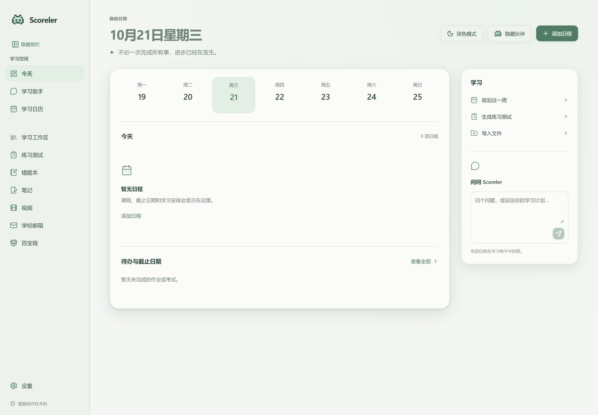

### 学习日历

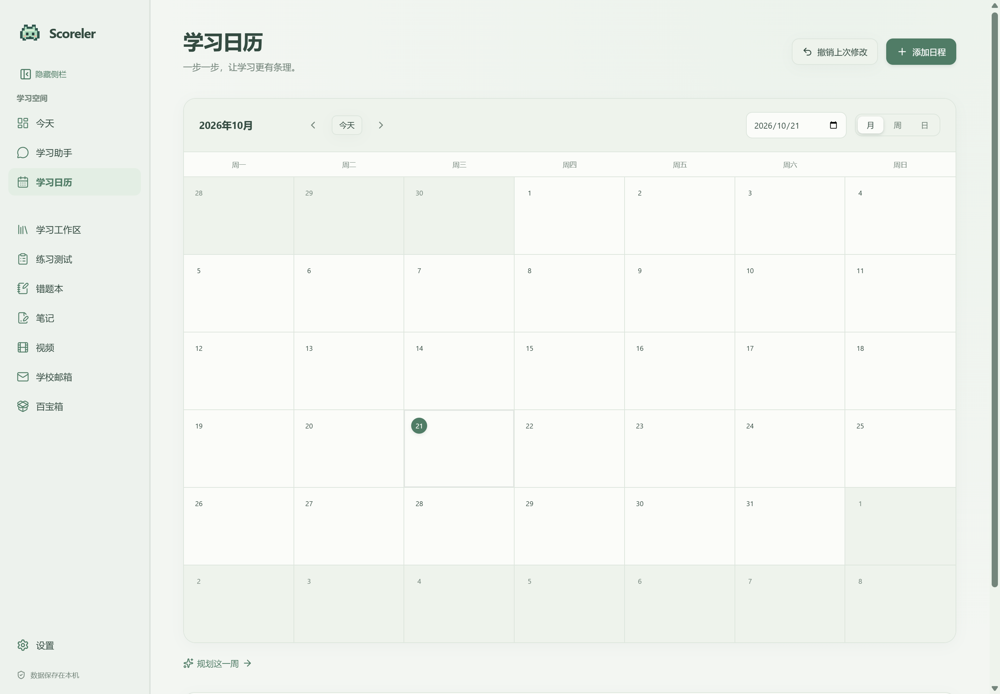

### AI 学习助手

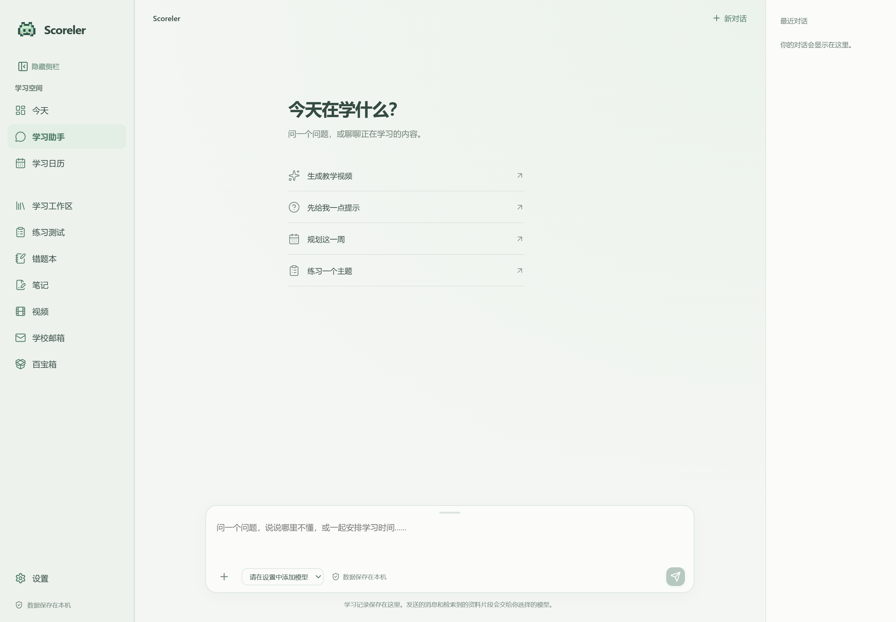

### 学习工作区

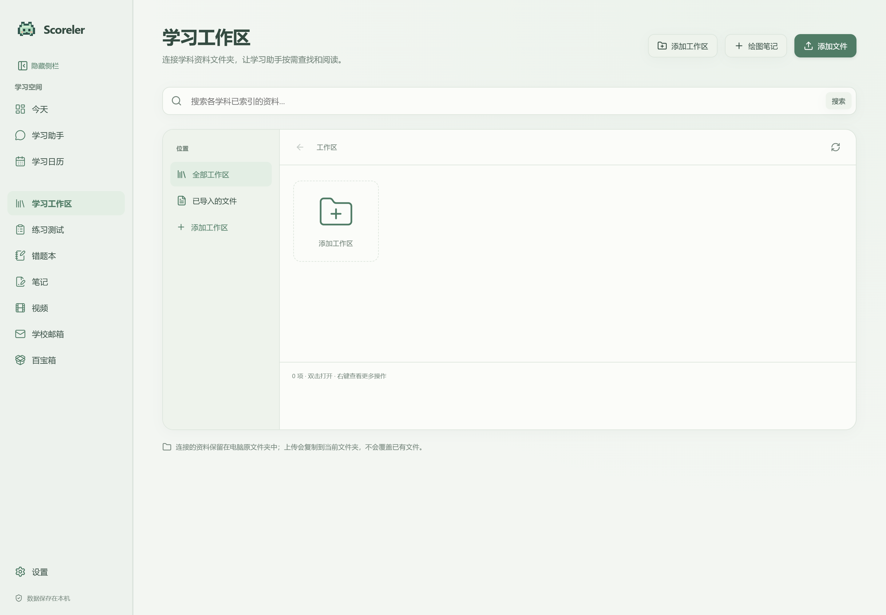

### 笔记

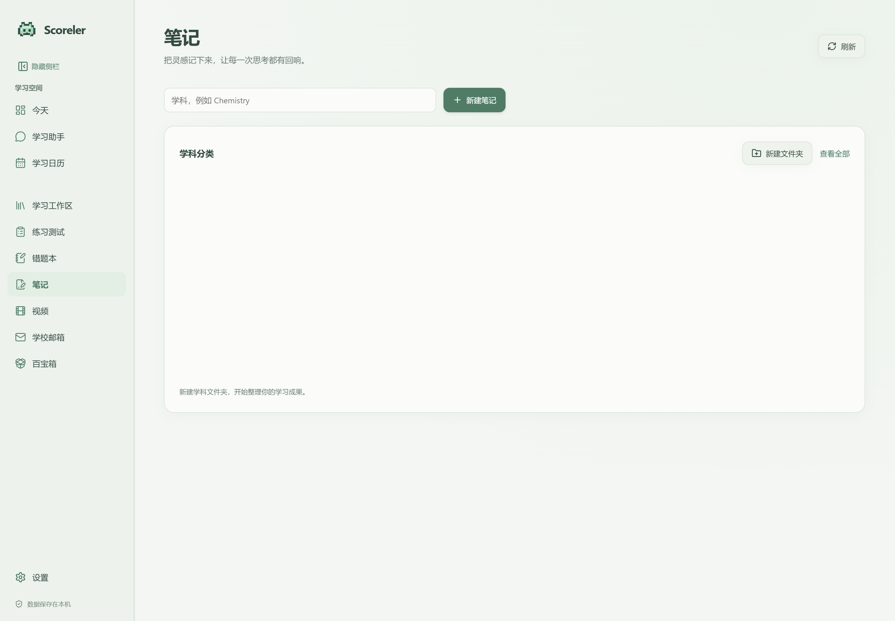

### 教学视频

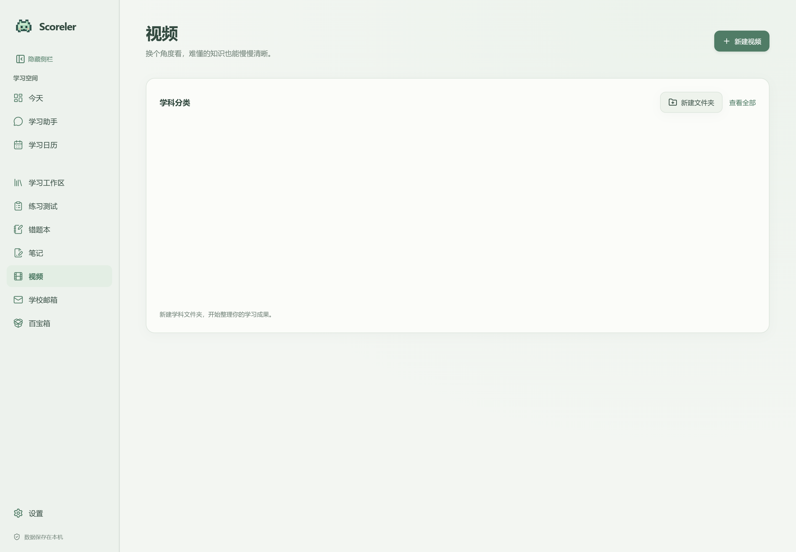

### 练习测试

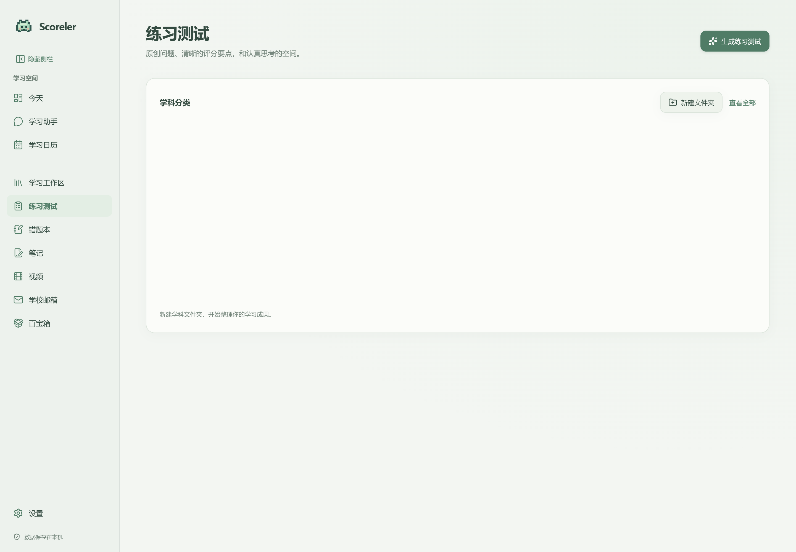

### 错题本

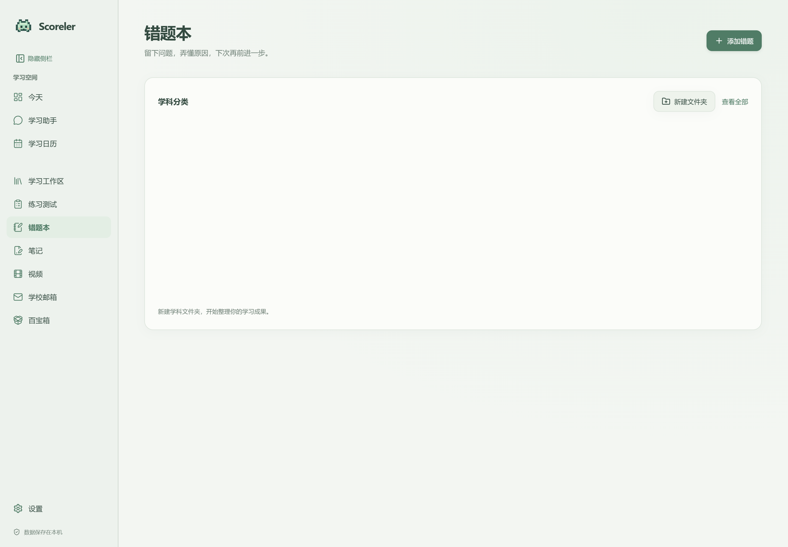

### 邮箱配置

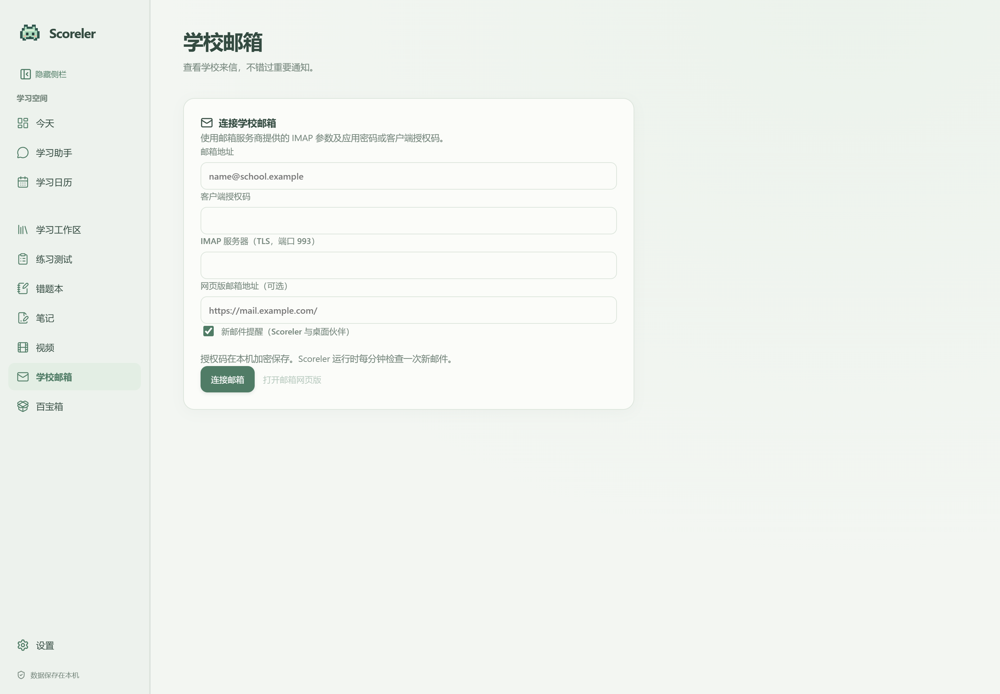

### 百宝箱

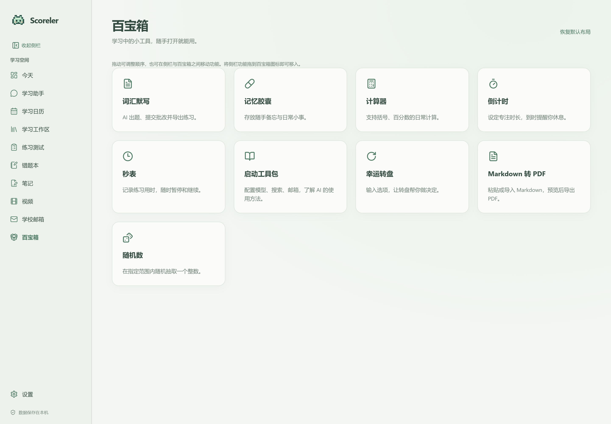

### 听写与默写

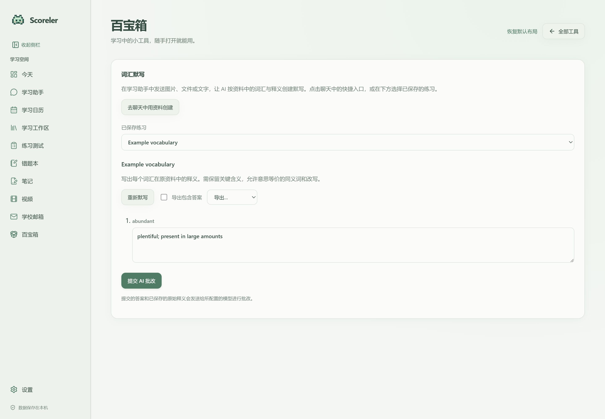

## 功能

- **日程规划：**管理课程、作业、考试、截止日期和学习安排；标记完成；显示近期提醒，今日视图隐藏已经结束的课程。
- **AI 学习助手：**保存对话、附加图片、调用学习工具、搜索已连接资料、解释知识并按要求修改支持的学习记录。工具调用与图片理解能力取决于所配置的模型。
- **学习工作区：**连接本地文件夹、导入文档、浏览资料并搜索索引。连接的原始文件保留在原位置。
- **笔记：**学科文件夹、文字与绘图编辑、保存、导出和“发送给 AI”草稿。
- **教学视频：**AI 编写教学脚本，本地使用 Remotion 渲染；支持学科分类、播放、导出和讨论，配音使用已安装的 Windows 系统语音。
- **练习测试：**学科分类、练习卷、作答记录、评分参考、导出和 AI 讨论。生成内容属于学习练习，并非官方试卷。
- **错题本：**保存题目、答案和订正截图，标记解决，批量选择，导出 PDF、DOCX 或 PNG，并与 AI 讨论。
- **记忆胶囊：**位于百宝箱，保存非待办性质的简短事实。作业、课程、截止日期和其他任务应记录在日历，即使用户使用“记住”一词。
- **邮箱：**IMAP 收件箱、搜索、格式化阅读、链接、到信通知和 AI 摘要，需要兼容的邮箱服务及客户端授权凭据。
- **可选内置浏览器：**默认关闭，支持自行配置网站、保存会话和加密保存登录信息。网站限制可能阻止内嵌登录。
- **桌面伙伴：**可拖动像素伙伴，显示日程与提醒，完成任务，附加图片并进入聊天，支持屏幕边缘隐藏及悬停显示。
- **外观：**浅色与深色模式、四套主题配色、对应伙伴配色和表情、可隐藏侧栏。
- **听写与默写：**在聊天中发送图片、文件或文字，AI 读取其中的词汇及释义并保存默写；从聊天快捷入口或百宝箱打开，根据词汇填写释义（也支持反向默写）。AI 按原文含义批改，接受等义词和准确改写，但不接受遗漏关键含义。作答草稿保存在本机；支持 PDF、PNG、DOCX 导出，默认不包含答案，需主动勾选。生成内容与评分需核对。
- **百宝箱：**计算器、倒计时、秒表、转盘、随机数、Markdown 转 PDF 和入门指南。计时状态在切换页面后保留。
- **应用更新：**显示版本与提交信息，检查 GitHub 仓库源代码更新，可自动准备更新并在退出后、下次启动时启用。

## 状态与限制

已实现的功能仍依赖具体模型、邮箱服务、网站和 Windows 环境。自动化测试覆盖部分存储、界面和更新行为，无法保证所有外部服务兼容。AI 可以读取保存的视频脚本和来源，并不等同于观看视频画面。邮箱助手不读取附件，也不提供发送或删除邮件功能。AI 自动操作内置网站尚未实现。内置浏览器不导入其他浏览器的密码。

## Windows 环境要求

- 64 位 Windows 10 或 11；当前开发目标为 Windows 11。
- Node.js 24 或更新版本、npm、Git for Windows。
- 能访问依赖下载及自行配置的外部服务。
- Windows PowerShell；视频配音需要已安装的兼容语音。
- Remotion 渲染需要 Chromium，首次使用可能下载浏览器。

现有视频流程无需单独安装 Python 或 FFmpeg，渲染与编码工具由 Remotion 平台依赖提供。可选文档转换集成可能需要其他工具。

## 从源码安装

公开仓库的更新下载无需 GitHub 登录。使用私有仓库时，需要每位使用者自己的 GitHub 访问权限及 Git Credential Manager 身份验证。请勿将令牌写入源码、仓库地址或聊天。

```powershell
git clone --branch main https://github.com/HansonFeng123/Scoreler.git
cd Scoreler
npm ci
npm run build
npm run desktop
```

`npm ci` 会执行依赖安装脚本，Electron 可能下载运行环境。`npm run desktop` 会重新构建并启动桌面应用。

单独构建与测试：

```powershell
npm --workspace inno-agent run build
node scripts/scoreler-video-build.mjs
npm --workspace inno-agent-web run build
npm test
npm run test:updater
```

构建后可通过 `npm start` 启动仅浏览器模式，访问输出的本机地址。桌面邮箱、内置浏览器和伙伴集成需要 Electron。本地打包命令为 `npm run package:win`。二进制分发涉及独立的依赖许可要求，参见 [第三方声明](THIRD_PARTY_NOTICES.md)。

## 服务配置

### 模型

在“设置 → 服务商与模型”填写服务商名称、官方文档中的 API 类型和基础地址、所需密钥及准确模型 ID。保存后在聊天中选择模型。仅在模型与端点确实支持时启用工具调用或图片输入；勾选本身不会赋予模型这些能力。服务价格、资格、配额及隐私政策由对应服务商决定。

### 网络检索

可在设置中配置 Tavily API 密钥。模型密钥与检索密钥不同。搜索请求会发送给检索服务，检索结果可能作为模型请求的一部分。

### 邮箱

在邮箱服务端启用 IMAP，并按要求获取应用密码或客户端授权码。填写邮箱地址、IMAP 主机、TLS 端口 993 和授权码，可自行配置网页版邮箱地址。仅支持 OAuth 或受管理员限制的邮箱可能不兼容。AI 摘要同时需要可用邮箱连接及模型。

### 内置浏览器

在设置中启用，再填写自己的 HTTPS 网站地址，通过网站完成登录及多因素验证。会话保存在本机。若网站禁止内嵌登录，请使用系统浏览器。

## 数据、备份与隐私

桌面资料通常位于 `%APPDATA%\scoreler-desktop`，学习数据位于其中的 `study`，包括 SQLite 数据库、聊天、笔记、视频、生成文件、配置和日志。浏览器会话与本地偏好也在资料目录。`SCORELER_HOME` 或 `--scoreler-home=` 可指定学习数据位置，重新启动时应保持一致。

仅浏览器开发模式默认使用源码目录下的 `runtime/scoreler`，与桌面默认资料库不同。切换启动方式后出现空页面可能意味着使用了不同数据目录，并不一定是记录被删除。

手动备份时请关闭应用，复制完整资料目录，包括学习目录和 SQLite 伴随文件；连接的原始资料文件夹需另行备份。备份应保密。Windows 加密的邮箱或浏览器凭据不一定能跨账户、跨电脑使用，迁移后可能需要重新连接。

后端使用本机回环地址，通常为 `127.0.0.1:3000`，端口占用时选择其他可用端口。这不是公开托管地址。

本地保存不代表所有处理离线：

- 消息、选中的图片、相关资料和工具结果可能发送给选定模型服务。
- 搜索查询发送给检索服务。
- 邮箱连接访问指定邮件服务器，用于 AI 摘要的邮件正文会发送给模型。
- 内置网站访问其服务器并保存 Cookie 或会话。
- 依赖安装、浏览器准备和更新会联系对应下载服务。

模型密钥保存在本地配置中，应视为秘密。邮箱授权码和保存的浏览器登录使用桌面加密机制。不要在记忆、源码、截图或提交中保存秘密。分享日志或导出内容前应自行检查。

## 更新

`source-update.json` 指定本版的 `main` 更新分支。私有仓库授权用户需在自己的设备上配置 Git 身份，凭据不会随应用提供。

在“设置 → 应用更新”检查更新。开启自动更新后立即开始检查与准备，之后定期检查；准备过程不打断当前工作，新版本在退出后、下次启动时启用。启用前自动备份现有资料，学习记录保留在原目录。构建失败时保留之前可用的运行版本，诊断日志位于资料目录的 `updates` 中。

桌面更新会下载并构建源码，需要 Node.js、npm、Git 和依赖下载访问权限，不是下载预编译 EXE 的服务。已验证一次从安装版到私有仓库源码版本的完整更新，包括自动备份、启用和学习记录数量保持。

源码工作副本也可使用：

```powershell
npm run update:check
npm run update:apply -- --confirm --expected <40位目标提交>
```

应用更新前保存工作并关闭应用。源码更新器检查仓库、分支、源地址和本地修改，拒绝分叉及变化的目标提交；快进后安装依赖并构建。构建失败时回退源码，重新运行 `npm ci` 与 `npm run build` 后再打开。

## 常用操作

在日历中创建课程、作业、考试或学习安排，在主界面或桌面伙伴标记完成。向 AI 提出问题或附加图片前选择兼容模型。“发送给 AI”会准备可编辑草稿，不会直接发送。服务凭据请填写到配置表单。

连接本地资料后等待索引完成。笔记、视频、练习和错题支持学科分类，新生成内容优先显示。计算器支持括号、运算优先级、正负号、百分比和科学计数法；百分号表示除以 100，例如 `200 × 15% = 30`，不使用商业计算器的隐式百分比规则。

## 更新日志

### 1.0.0

- 仅在确实存在可用更新时显示新版本提示。
- 支持无需 GitHub 登录下载公开仓库的更新。
- 保留准备步骤进度、启用前自动备份、布局保存和基于资料的词汇默写。

### 0.8.6

- 修复测试引用前端 JSX 导致本地服务构建失败的问题。
- 返回设置时恢复更新状态，新增按准备步骤显示的进度条，并明确显示准备失败。

### 0.8.5

- 拖动调整侧栏和百宝箱的功能顺序，并在两者之间移动功能；布局保存在本机。
- 在聊天中发送图片、文件或文字，以其中的词汇及释义创建默写，支持聊天快捷打开。
- 根据原文释义严格批改，接受等义表达；保存作答草稿，支持包含或不包含答案的导出。
- 设置 Windows 窗口图标及重新启动身份为 Scoreler。

### 0.8.4

- 修复 Markdown 长表格与后续段落在预览和导出中重叠的问题。

- 收起侧栏后保留可点击的图标栏，仍可切换所有页面。

- 自动更新复选框与其他设置保持一致。
- 分离后台准备与重启，显示构建阶段并检测已停止的任务。
- 复用未变化的锁定依赖，重启沿用同一资料目录，启用前自动备份。

### 0.8.3

- 新增 AI 默写练习生成、保存、答案提交、批改与导出。
- 默认导出空白作答卷，答案需主动选择包含。

### 0.8.2

- 增加百宝箱计算器与设置版本信息。
- 自动准备更新，在下次启动时启用，并在启用前自动备份。
- 将记忆胶囊移入百宝箱。
- 指示 AI 将“记住作业”等任务保存到日历。
- 调整自动更新控件布局，并复用兼容的 Electron 运行环境。
- 分别提供英文、中文说明和对应语言截图。

### 0.8.1

- 增加安装版源码更新支持及运行依赖修复。

### 0.8.0

- 提供 Windows 桌面学习界面、学习资料与工具功能。

## 故障排查

- **记录看起来为空：**确认启动方式和资料目录一致，不要删除原目录。
- **模型无法调用工具或理解图片：**核实实际模型和端点支持对应能力，检查配置与服务配额。
- **更新失败：**检查 GitHub 权限、网络、Node.js/npm/Git 和 `updates` 日志；保留原有资料。
- **网站无法内嵌登录：**改用系统浏览器。
- **视频无法配音或渲染：**检查系统语音、浏览器下载和渲染日志。

## 许可与致谢

Scoreler 自身贡献适用 [MIT 许可证](LICENSE)。依赖、字体、图标、媒体和其他组件保留各自许可，详细版本、来源与声明见 [THIRD_PARTY_NOTICES.md](THIRD_PARTY_NOTICES.md)、[DEPENDENCIES.json](DEPENDENCIES.json) 和 `third-party-licenses/`。

Remotion 使用独立许可，不能将整套依赖标记为 MIT。发布引用依赖的源码与分发包含依赖的安装包是不同事项；二进制分发前应核实 Remotion、编码组件等的实际条款与未解决事项。声明清单不构成对所有使用场景的法律保证。
