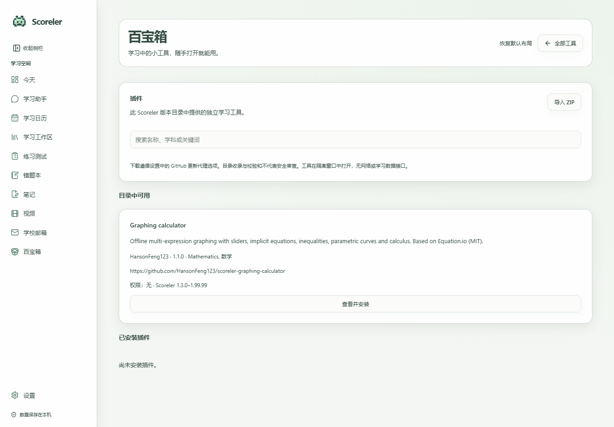

# Scoreler

Scoreler 是一个专注于学习的个人 AI Agent。

[English](README.md) | 简体中文

Scoreler 是面向学生的本地学习助手，将日程规划、AI 学习助手、学习资料和实用工具集中在一个 Windows 桌面应用中，支持英文和简体中文界面。

## 功能截图

以下截图来自独立的演示资料库，不包含个人记录或服务凭据。

### 今天与学习安排


### 学习日历


### AI 学习助手


### 学习工作区


### 笔记


### 教学视频


### 练习测试


### 错题本


### 邮箱配置


### 百宝箱


### 听写与默写


### 百宝箱插件

[离线中英双向翻译插件](https://github.com/HansonFeng123/scoreler-offline-translator)内置两个 OPUS-MT 模型与浏览器 CPU 运行时。更新至 Scoreler 1.3.2 后，在插件目录安装。模型全部包含在安装包中，因此下载较大；翻译文本仅在隔离工具内处理，不保存历史。致谢：赫尔辛基大学 / OPUS-MT（英译中 Apache-2.0，中译英 CC-BY-4.0）、Xenova ONNX 转换、Transformers.js（Apache-2.0）和 ONNX Runtime（MIT）。完整来源、许可与质量限制见插件 README。




## 功能

- **日程规划：**管理课程、作业、考试、截止日期和学习安排；标记完成；显示近期提醒，今日视图隐藏已经结束的课程。
- **AI 学习助手：**保存对话、附加图片、调用学习工具、搜索已连接资料、解释知识并按要求修改支持的学习记录。工具调用与图片理解能力取决于所配置的模型。
- **学习工作区：**连接本地文件夹、导入文档、浏览资料并搜索索引。连接的原始文件保留在原位置。
- **笔记：**学科文件夹、文字与绘图编辑、保存、导出和“发送给 AI”草稿。
- **教学视频：**AI 编写教学脚本，本地使用 Remotion 渲染；支持学科分类、播放、导出和讨论，配音使用已安装的 Windows 系统语音。
- **练习测试：**学科分类、练习卷、作答记录、评分参考、导出和 AI 讨论。生成内容属于学习练习，并非官方试卷。
- **错题本：**保存题目、答案和订正截图，标记解决，批量选择，导出 PDF、DOCX 或 PNG，并与 AI 讨论。
- **记忆胶囊：**位于百宝箱，保存非待办性质的简短事实。作业、课程、截止日期和其他任务应记录在日历，即使用户使用“记住”一词。
- **邮箱：**IMAP 收件箱、搜索、格式化阅读、链接、到信通知和 AI 摘要，需要兼容的邮箱服务及客户端授权凭据。
- **可选内置浏览器：**默认关闭，支持自行配置网站、保存会话和加密保存登录信息。网站限制可能阻止内嵌登录。
- **桌面伙伴：**可拖动像素伙伴，显示日程与提醒，完成任务，附加图片并进入聊天，支持屏幕边缘隐藏及悬停显示。
- **外观：**浅色与深色模式、四套默认主题，以及可保存的自定义主题；支持 RGB 背景颜色、本地背景图片和强调色。启动加载页和运行中的应用图标随已保存主题变化；Windows 可能缓存已固定的快捷方式图标。侧栏收起后仍可点击功能图标。
- **对话管理：**右键最近对话并确认后删除，已保存的学习资料、笔记和视频保留。
- **倒计时提醒：**桌面应用在主进程安排系统通知，切换页面或界面繁忙时仍可提醒。需要应用保持运行，通知显示受 Windows 通知设置影响。
- **听写与默写：**在聊天中发送图片、文件或文字，AI 读取其中的词汇及释义并保存默写；从聊天快捷入口或百宝箱打开，根据词汇填写释义（也支持反向默写）。AI 按原文含义批改，接受等义词和准确改写，但不接受遗漏关键含义。作答草稿保存在本机；支持 PDF、PNG、DOCX 导出，默认不包含答案，需主动勾选。生成内容与评分需核对。
- **百宝箱：**计算器、倒计时、秒表、转盘、随机数、Markdown 转 PDF 和入门指南。计时状态在切换页面后保留。
- **应用更新：**显示版本与提交信息，检查 GitHub 仓库源代码更新，可自动准备更新并在退出后、下次启动时启用。

## 状态与限制

已实现的功能仍依赖具体模型、邮箱服务、网站和 Windows 环境。自动化测试覆盖部分存储、界面和更新行为，无法保证所有外部服务兼容。AI 可以读取保存的视频脚本和来源，并不等同于观看视频画面。邮箱助手不读取附件，也不提供发送或删除邮件功能。AI 自动操作内置网站尚未实现。内置浏览器不导入其他浏览器的密码。

## Windows 环境要求

- 64 位 Windows 10 或 11；当前开发目标为 Windows 11。
- Node.js 24 或更新版本、npm、Git for Windows。
- 能访问依赖下载及自行配置的外部服务。
- Windows PowerShell；视频配音需要已安装的兼容语音。
- Remotion 渲染需要 Chromium，首次使用可能下载浏览器。

现有视频流程无需单独安装 Python 或 FFmpeg，渲染与编码工具由 Remotion 平台依赖提供。可选文档转换集成可能需要其他工具。

## 从源码安装

公开仓库的更新下载无需 GitHub 登录。使用私有仓库时，需要每位使用者自己的 GitHub 访问权限及 Git Credential Manager 身份验证。请勿将令牌写入源码、仓库地址或聊天。

```powershell
git clone --branch main https://github.com/HansonFeng123/Scoreler.git
cd Scoreler
npm ci
npm run build
npm run desktop
```

`npm ci` 会执行依赖安装脚本，Electron 可能下载运行环境。`npm run desktop` 会重新构建并启动桌面应用。

单独构建与测试：

```powershell
npm --workspace inno-agent run build
node scripts/scoreler-video-build.mjs
npm --workspace inno-agent-web run build
npm test
npm run test:updater
```

构建后可通过 `npm start` 启动仅浏览器模式，访问输出的本机地址。桌面邮箱、内置浏览器和伙伴集成需要 Electron。本地打包命令为 `npm run package:win`。二进制分发涉及独立的依赖许可要求，参见 [第三方声明](THIRD_PARTY_NOTICES.md)。

## 服务配置

### 模型

在“设置 → 服务商与模型”填写服务商名称、官方文档中的 API 类型和基础地址、所需密钥及准确模型 ID。保存后在聊天中选择模型。仅在模型与端点确实支持时启用工具调用或图片输入；勾选本身不会赋予模型这些能力。服务价格、资格、配额及隐私政策由对应服务商决定。

### 网络检索

可在设置中配置 Tavily API 密钥。模型密钥与检索密钥不同。搜索请求会发送给检索服务，检索结果可能作为模型请求的一部分。

### 邮箱

在邮箱服务端启用 IMAP，并按要求获取应用密码或客户端授权码。填写邮箱地址、IMAP 主机、TLS 端口 993 和授权码，可自行配置网页版邮箱地址。仅支持 OAuth 或受管理员限制的邮箱可能不兼容。AI 摘要同时需要可用邮箱连接及模型。

### 内置浏览器

在设置中启用，再填写自己的 HTTPS 网站地址，通过网站完成登录及多因素验证。会话保存在本机。若网站禁止内嵌登录，请使用系统浏览器。

### ChatGPT 套餐登录

Scoreler 根据公开的 [OpenAI OAuth 流程](https://developers.openai.com/siwc/token-sharing-open-source/sign-in)与 [Responses 接口](https://developers.openai.com/siwc/token-sharing-open-source/models-and-inference)实现，须遵守[官方条款](https://openai.com/policies/sign-in-with-chatgpt-terms/)。集成位于 packages/scoreler-chatgpt，为 Scoreler 自有代码，仅通过公开接口调用未经修改的官方 OpenAI SDK；不包含或修改 Sign in with ChatGPT DevKit。Scoreler 是免费、非商业、本地运行的开源项目，不声称获 OpenAI 背书。

在桌面设置的模型区域阅读隐私说明，明确勾选套餐授权意愿，再点击 Continue with ChatGPT，由本人在官方浏览器页面完成授权。不要粘贴密码、Cookie、会话令牌或其他应用凭据。须符合账号、套餐、工作区和地区资格，不得绕过限制。原有 API 密钥服务商保持独立可用。

刷新账号模型目录后选择模型；只有目录明确声明支持时才显示推理档位，否则使用模型默认。对话输入区也可选择模型和受支持的推理档位。官方 DeepSeek API 的 deepseek-flash 与 deepseek-v4-pro 提供关闭、Low、High、Max。推理档位改变伙伴表情，但保持主题配色。

授权与由操作系统加密的凭据只留在 Electron 主进程，无明文降级或本地通用 HTTP 代理。默认每轮用户对话先显示系统确认，覆盖本次回复及工具后续请求。可勾选“不再询问我发送的消息”，在本地为当前连接账号记住选择，并可在设置中恢复。只有桌面对话界面登记的当前轮次可使用该许可；后台学习使用须单独明确授权。系统提示可为默写生成、批改及你启用的学习自动化记住后台许可，也可在设置中恢复询问。该许可仅绑定当前账号、保存在本机，并在断开时清除。仅记住对话许可不会授予后台访问。拒绝不发送推理内容。仅向官方 Responses 地址发送 store:false、stream:true 请求。相关指令、对话、选中的学习记忆和资料片段、受支持图片及本地工具结果会发送给 OpenAI；登录不会导入 ChatGPT 对话。凭据不传给渲染器或后端子进程。加密连接可跨重启保留；断开会移除令牌并尝试远程撤销，失败时应到 ChatGPT 设置管理访问。

受套餐和应用用量限制，不提供无限使用或通用 API 额度。用量与访问管理：https://chatgpt.com/settings/usage。不支持的模型能力会报错；本流程不提供托管文件搜索、图像生成、Code Interpreter、托管 MCP、音视频输入或 Files 上传。文档继续使用 Scoreler 本地提取流程。系统加密无法抵御已在同一用户身份下运行的恶意程序，也无法保证账号绝不受限制。

玻璃透明度为 0–90%，自动本地保存。滑块仅改变玻璃底色的不透明度，0–90% 范围内模糊、亮度及对比度保持不变。输入框与弹窗保持实底，系统减少透明度和高对比度设置优先。

验证情况：用户已通过当前适配器完成官方浏览器授权；真实模型发现、简短学习对话、合成图片、本地函数调用及其后续回复均已通过。加密连接在独立进程重启后仍可用。干净的 Windows 1.2.0 包已使用隔离默认配置成功启动并显示 Scoreler。自动化还覆盖刷新、拒绝权限、额度错误、流中断、存储、响应式控件及更新回滚。模拟失败与账号实测分别记录，不能保证所有账号、模型、Windows 安装或外部服务兼容。

ChatGPT 网络设置支持保存 SOCKS5/HTTP/HTTPS 代理，并独立开启或关闭；关闭后仍保留地址，可选择使用系统设置或直接连接。此设置仅作用于 ChatGPT 登录、账号模型列表与学习请求；外部浏览器授权使用浏览器自己的设置，其他 API 服务商保留原有网络设置。连接测试仅访问公开的 OpenAI 配置，不发送凭据，不代表完成账号授权。暂不支持需要账号密码的代理，地址只保存在本机桌面资料中，不进入学习数据导出。

条款核对（2026-10-26）：修改过的 DevKit 开发稿已从发行源码移除。Scoreler 自有协议适配器现仅调用文档公开的服务接口及未经修改的官方 OpenAI SDK。已对授权、本地加密、用户同意、仅限本应用使用、套餐限制及断开行为进行实现核对与模拟测试；不代表 OpenAI 审批或账号不会被停用。真实账号验证与模拟失败、刷新及额度测试分别记录。

发行回归测试通过合成模型检查真实前端、预加载桥接、后端及主进程：发送学习指令与 42 个工具，实际创建本地笔记，并将结果返回后续请求。此合成测试不请求 OpenAI。模型选择测试确认已配置的 API 模型与 ChatGPT 同时保留。

### 百宝箱插件

进入百宝箱 → 插件，在随应用更新的目录内搜索。安装前核对作者、来源、版本、兼容性、权限与校验值；校验值证明内容完整，不证明安全。也可导入明确取得的本地 ZIP。已安装项可打开、禁用、卸载或预览目录提供的更新。更新失败会保留原版本。

已安装并启用的插件直接显示在百宝箱中。点击卡片即可在 Scoreler 同一窗口的隔离视图中使用离线工具，点击「全部工具」返回；不提供学习记录、模型密钥、Node、Electron 或网络接口。工具状态仅在当前视图内保存，离开工具即丢失。浏览器沙箱不是操作系统容器，仍可能存在浏览器漏洞或资源耗尽风险。插件目录不能通过插件自身更改。详见 [插件格式](docs/plugins.md)。

图形计算器是独立的 [开源插件](https://github.com/HansonFeng123/scoreler-graphing-calculator)，基于 Anthony Foster 的 Equation.io（MIT），保留完整许可与界面致谢。提供多表达式、滑块、隐式方程、不等式、分段函数、参数曲线、导数与回归示例；采用 Equation.io 语法，不保证与 Desmos 完全兼容。当前不支持云端保存、文件导入导出、剪贴板集成或后台求解线程，离开工具即丢弃图形状态。插件下载遵循应用更新中的代理开关；使用代理需要系统提供 curl，代理地址不传给插件。

## 数据、备份与隐私

桌面资料通常位于 `%APPDATA%\scoreler-desktop`，学习数据位于其中的 `study`，包括 SQLite 数据库、聊天、笔记、视频、生成文件、配置和日志。浏览器会话与本地偏好也在资料目录。`SCORELER_HOME` 或 `--scoreler-home=` 可指定学习数据位置，重新启动时应保持一致。

仅浏览器开发模式默认使用源码目录下的 `runtime/scoreler`，与桌面默认资料库不同。切换启动方式后出现空页面可能意味着使用了不同数据目录，并不一定是记录被删除。

手动备份时请关闭应用，复制完整资料目录，包括学习目录和 SQLite 伴随文件；连接的原始资料文件夹需另行备份。备份应保密。Windows 加密的邮箱或浏览器凭据不一定能跨账户、跨电脑使用，迁移后可能需要重新连接。

后端使用本机回环地址，通常为 `127.0.0.1:3000`，端口占用时选择其他可用端口。这不是公开托管地址。

本地保存不代表所有处理离线：

- 消息、选中的图片、相关资料和工具结果可能发送给选定模型服务。
- 搜索查询发送给检索服务。
- 邮箱连接访问指定邮件服务器，用于 AI 摘要的邮件正文会发送给模型。
- 内置网站访问其服务器并保存 Cookie 或会话。
- 依赖安装、浏览器准备和更新会联系对应下载服务。

模型密钥保存在本地配置中，应视为秘密。邮箱授权码和保存的浏览器登录使用桌面加密机制。不要在记忆、源码、截图或提交中保存秘密。分享日志或导出内容前应自行检查。

## 更新

`source-update.json` 指定本版的 `main` 更新分支。私有仓库授权用户需在自己的设备上配置 Git 身份，凭据不会随应用提供。

在“设置 → 应用更新”检查更新。开启自动更新后立即开始检查与准备，之后定期检查；准备过程不打断当前工作，新版本在退出后、下次启动时启用。启用前自动备份现有资料，学习记录保留在原目录。构建失败时保留之前可用的运行版本，诊断日志位于资料目录的 `updates` 中。

桌面更新会下载并构建源码，需要 Node.js、npm、Git 和依赖下载访问权限，不是下载预编译 EXE 的服务。已验证一次从安装版到私有仓库源码版本的完整更新，包括自动备份、启用和学习记录数量保持。

源码工作副本也可使用：

```powershell
npm run update:check
npm run update:apply -- --confirm --expected <40位目标提交>
```

应用更新前保存工作并关闭应用。源码更新器检查仓库、分支、源地址和本地修改，拒绝分叉及变化的目标提交；快进后安装依赖并构建。构建失败时回退源码，重新运行 `npm ci` 与 `npm run build` 后再打开。

## 常用操作

在日历中创建课程、作业、考试或学习安排，在主界面或桌面伙伴标记完成。向 AI 提出问题或附加图片前选择兼容模型。“发送给 AI”会准备可编辑草稿，不会直接发送。服务凭据请填写到配置表单。

连接本地资料后等待索引完成。笔记、视频、练习和错题支持学科分类，新生成内容优先显示。计算器支持括号、运算优先级、正负号、百分比和科学计数法；百分号表示除以 100，例如 `200 × 15% = 30`，不使用商业计算器的隐式百分比规则。

## 更新日志

### 1.3.2

- 插件目录新增可下载的离线中英双向神经翻译，内置 OPUS-MT 模型、Transformers.js 和 ONNX Runtime，附完整开源致谢与许可。安装后无需账号、API 密钥或网络。
- 增加支持模型大小安装包的独立 WebAssembly 插件格式；原有 v1 工具保留大小与沙箱限制。
- 翻译在 CPU 上运行，短句质量与首次加载速度取决于模型和电脑，重要译文请核对。

### 1.3.1

- 已安装插件直接显示在百宝箱，并在 Scoreler 同一窗口中打开，保留原有离线沙箱限制。
- 对齐默写学科输入与保存按钮，为学科文件夹导航增加玻璃面板。
- 批改按钮旁新增可选批改要求，并随每次提交保存，在作答历史中显示。
- 构建、18 项针对性测试、真实桌面默写和插件流程、内嵌图形计算器隔离检查通过。详见[验证记录](docs/verification-1.3.1.md)。

### 1.3

本次测试范围与已知限制见[验证记录](docs/verification-1.3.md)。

- 默写练习采用学科文件夹与卡片，保留草稿和历次作答，支持历史回看与确认删除。
- ChatGPT 后台学习请求可在单独明确授权后选择“不再询问”，可随时在设置中恢复，并与对话许可分别管理。

- 在百宝箱内增加插件目录、来源与权限预览、本地 ZIP 导入、安装、禁用、卸载及目录限定的更新。
- 插件在独立隔离工具窗口运行，默认不能访问网络、凭据或学习记录。
- 新增图形计算器示例插件；已验证真实 GitHub 下载、1.0 到 1.1 更新、失败保留旧版及绘图流程。
- 更新日志仅展开最新次版本的补丁，旧次版本合并展示。

### 1.2

- 可选 ChatGPT 套餐登录、受支持模型与推理强度选择；保留原有 API 服务商。
- 增加可保存的网络代理、更新下载进度与失败恢复；改进透明度和对话布局。

### 1.1

- 自定义背景与主题、玻璃材质、主题伙伴与 Windows 图标；修复更新启动及对话删除。

### 1.0

- 完善学习助手、日历、资料、笔记、练习、视频与本地数据工作流。

### 0.8

- 建立桌面应用、双语界面、学习计划与资料管理基础。

## 故障排查

- **记录看起来为空：**确认启动方式和资料目录一致，不要删除原目录。
- **模型无法调用工具或理解图片：**核实实际模型和端点支持对应能力，检查配置与服务配额。
- **更新失败：**检查 GitHub 权限、网络、Node.js/npm/Git 和 `updates` 日志；保留原有资料。
- **网站无法内嵌登录：**改用系统浏览器。
- **视频无法配音或渲染：**检查系统语音、浏览器下载和渲染日志。

## 许可与致谢

Scoreler 自身贡献适用 [MIT 许可证](LICENSE)。依赖、字体、图标、媒体和其他组件保留各自许可，详细版本、来源与声明见 [THIRD_PARTY_NOTICES.md](THIRD_PARTY_NOTICES.md)、[DEPENDENCIES.json](DEPENDENCIES.json) 和 `third-party-licenses/`。

Remotion 使用独立许可，不能将整套依赖标记为 MIT。发布引用依赖的源码与分发包含依赖的安装包是不同事项；二进制分发前应核实 Remotion、编码组件等的实际条款与未解决事项。声明清单不构成对所有使用场景的法律保证。
